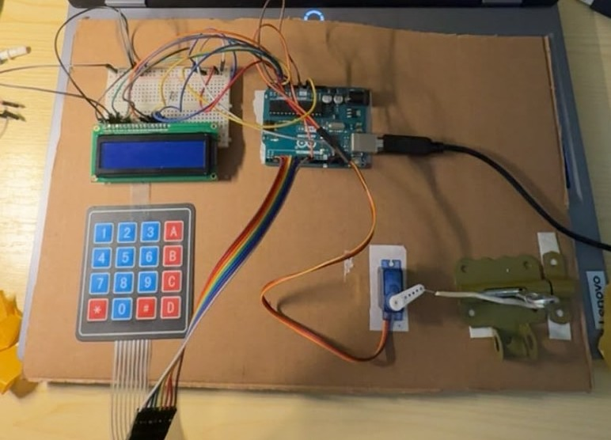

# Arduino Smart Access Control

**Embedded C++ | Arduino | 4×4 Keypad | LCD 16×2 | Servo | EEPROM**

An educational embedded-systems prototype that checks a four-digit PIN entered on a matrix keypad and actuates a physical latch using a servo motor. An LCD displays feedback and a buzzer provides audible signals.

## Hardware demonstration

[Watch the demonstration (MP4)](media/demo.mp4)

The video demonstrates the assembled prototype; it does not independently verify every feature present in the firmware.

## Implemented in the supplied source code

- Four-digit PIN entry, display masking, confirmation (`#`) and backspace (`C`)
- PIN change through an administrator workflow, with confirmation
- PIN persistence in EEPROM
- Temporary 10-second lockout after three incorrect PIN attempts
- Automatic reset of partial input after 10 seconds of inactivity
- PIN-protected service mode with a 15-second timeout
- Gradual servo movement between nominal closed (0°) and open (90°) positions
- LCD status feedback and buzzer tones

## Hardware connections (as configured in code)

| Component | Arduino pins |
| --- | --- |
| Keypad rows | D9, D8, D7, D6 |
| Keypad columns | D5, D4, D3, D2 |
| LCD RS, E, D4–D7 | A0, A1, A2–A5 |
| Servo signal | D10 |
| Buzzer | D11 |

This is a mapping from the source, not a separately verified wiring schematic. Confirm wiring and safe motor power before uploading.

## Files

- [`src/SmartAccessControl.ino`](src/SmartAccessControl.ino) — Arduino firmware
- [`media/prototype.jpg`](media/prototype.jpg) — hardware photograph
- [`media/demo.mp4`](media/demo.mp4) — silent portrait demonstration
- [`docs/Technical_Report.pdf`](docs/Technical_Report.pdf) — three-page technical documentation

## Reproduce / compile

1. Install Arduino IDE and the `Keypad` library.
2. Open `src/SmartAccessControl.ino` using Arduino IDE.
3. Select the compatible Arduino board and compile.
4. Verify the wiring, servo power supply, and common ground before uploading.

The `Servo`, `LiquidCrystal` and `EEPROM` libraries are available on compatible Arduino platforms.

## Verification status and limitations

The prototype has been photographed and filmed, and the provided source code has been reviewed. A clean build, all hardware features, power-cycle EEPROM retention and edge cases have **not** been independently verified.

This is an educational demo, **not a real security product**. The firmware uses hard-coded example credentials and stores the user PIN without encryption. Blocking `delay()` calls and dynamic `String` objects could be improved with a non-blocking state machine and fixed-size buffers.
